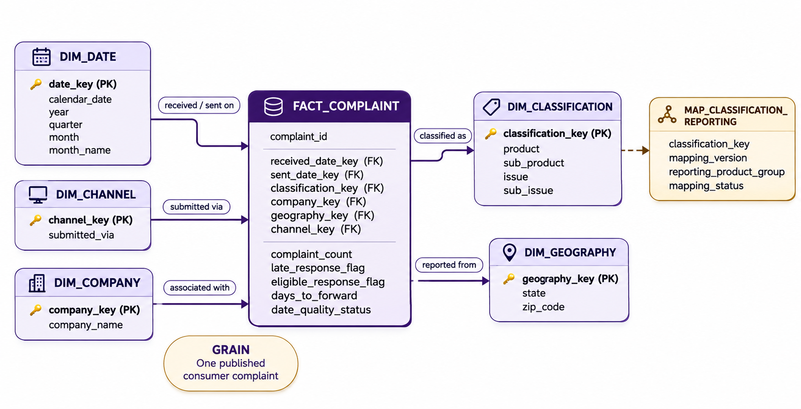

# P1 — Grain, Model, History & Pipeline Plan

## 1. Establish the question and check the source

### Audience and need

The primary audience is a compliance or customer-operations manager at a financial-services organization.

The manager needs a reliable way to monitor published consumer complaint patterns, identify product areas where complaint activity is changing, and decide where additional investigation may be needed.

### Primary analytical question

**Which comparable product groups show changes in monthly complaint volume over time, and where do those patterns suggest a need for further investigation?**

Supporting question:

**How does the late-response rate vary across those product groups over completed months?**

The same complaint-level fact table can support both questions.

### Material changes from P0

The audience, source, and proposed complaint grain remain the same as in P0.

After reviewing the P0 work, I made several improvements:

- Corrected the feasibility SQL filename and repository link.
- Expanded the date-quality profile to test both source date fields independently.
- Confirmed that both date fields are complete and parse successfully in the selected extract.
- Confirmed 7,050 reversed received/sent date pairs and defined them as exclusions from the future routing-days measure rather than exclusions from the complaint fact.
- Profiled product and sub-product combinations by month to investigate historical CFPB taxonomy changes.

The monthly profile showed an important boundary case around the April 24, 2017 CFPB form change. During April 2017, both legacy classifications such as `Consumer Loan` + `Vehicle loan` and newer classifications such as `Vehicle loan or lease` + `Loan` appear in the source.

This evidence means that a complaint should not be reclassified based only on its date. Original CFPB classifications will be preserved, and a separate reporting mapping will be used when comparable historical groups are required.

### Source object

The primary BigQuery source object is:

`seis-732-olivia.cfpb_raw.complaints_raw`

The selected extract contains 19,028,339 published complaint records with `date_received` values from 2011-12-01 through 2026-11-09.

### Source row meaning

One source row represents one published consumer complaint.

### Candidate identifier

The source field expected to uniquely identify one complaint is:

`complaint_id`

### Proposed fact grain

**One row represents one published consumer complaint in the selected CFPB extract.**

### Observed grain-check result

The grain check returned:

- Source rows: 19,028,339
- Rows with missing complaint ID: 0
- Repeated complaint ID groups: 0

### Grain conclusion

The observed results support the proposed transaction grain.

`complaint_id` is nonblank and unique across the selected extract, so each published complaint can be represented by one fact row. The identifier test establishes technical uniqueness, while the business process and analytical questions establish why one complaint is an appropriate analytical row.

The reproducible grain check is stored in:

[`sql/01_source_profile.sql`](../sql/01_source_profile.sql)
## 2. Define the model and predict a history consequence

### Business process and fact-table type

The warehouse models the **receipt and handling of published CFPB consumer complaints**.

The principal fact table will be `fact_complaint`, using a **transaction fact** design. The complaint grain established and tested in Section 1 will be carried forward into the dimensional model.

This design allows individual complaints to be summarized by time, classification, company, geography, and submission channel while preserving the meaning of one complaint per fact row.

### Proposed dimensional model

The proposed warehouse uses a star schema centered on `fact_complaint`.

The principal dimensions are:

| Table | One row represents | Main purpose |
| --- | --- | --- |
| `dim_date` | One calendar date | Supports monthly and yearly analysis and will be used in received-date and sent-to-company-date roles |
| `dim_classification` | One distinct original CFPB product, sub-product, issue, and sub-issue combination | Preserves the classification originally associated with each complaint |
| `dim_company` | One source company identity or label | Supports complaint and response analysis by company |
| `dim_geography` | One source geography combination | Supports analysis by state and available ZIP geography |
| `dim_channel` | One submission channel | Supports comparison of Web, Phone, Referral, Postal mail, Fax, and Email complaints |

`fact_complaint` will connect each complaint to the appropriate dimension rows through warehouse keys.

The original CFPB classification hierarchy will remain together in `dim_classification` because the meaning of an issue or sub-issue can depend on its product and sub-product context.

The dimensional model is shown below:

### Key strategy

`complaint_id` will remain the source business identifier in `fact_complaint`.

Each dimension will use a stable warehouse surrogate key:

- `date_key`
- `classification_key`
- `company_key`
- `geography_key`
- `channel_key`

These keys will appear as foreign keys in `fact_complaint`.

`dim_date` will be role-playing, using:

- `received_date_key`
- `sent_date_key`

The primary trend analysis will use `received_date_key`.

### Measures

The fact table will store complaint-level measures and flags that can be aggregated in the Serving layer.

| Field | Meaning |
| --- | --- |
| `complaint_count` | 1 for each complaint |
| `late_response_flag` | 1 when `timely_response = 'No'`, otherwise 0 for eligible Yes/No responses |
| `eligible_response_flag` | 1 when `timely_response` is Yes or No |
| `days_to_forward` | Days from CFPB receipt to company transmission for valid date pairs |
| `date_quality_status` | Indicates whether the date pair is valid for routing analysis |

The Serving layer will calculate:

**late-response rate = late-response count / eligible-response count**

Invalid routing-date pairs will remain in the complaint fact but will have a null `days_to_forward` value.

### Question-to-model trace

| Question component | Model element |
| --- | --- |
| Monthly complaint volume | `SUM(complaint_count)` from `fact_complaint` |
| Time | `received_date_key` joined to `dim_date`, grouped by completed month |
| Comparable product groups | `dim_classification` plus the documented reporting mapping |
| Late-response rate | `SUM(late_response_flag) / SUM(eligible_response_flag)` |
| Investigation detail | Company and geography dimensions can be used to drill into unusual product-group patterns |

The primary question will therefore be answered by grouping complaint facts by received month and comparable reporting product group, then comparing monthly complaint counts over time. The supporting late-response question will use the same grouping and calculate the late-response rate from the complaint-level flags.

### History and shared-meaning decision

The original CFPB product, sub-product, issue, and sub-issue values will be treated as fixed source history and preserved in `dim_classification`.

A separate versioned reporting mapping will be used when historically different source labels need to be grouped into a comparable reporting category.

For example, the April 2017 CFPB change moved vehicle-related classifications from `Consumer Loan` into the new `Vehicle loan or lease` product. CFPB documentation shows the legacy-to-new relationship, while the source profile shows both old and new classifications appearing during the transition period.

Because of this overlap, complaints will not be reassigned based only on date. The reporting mapping will use the original classification values and documented source evidence.

Type 2 history is not planned for this classification dimension because the source already preserves the classification originally reported for each complaint. The historical reporting need is better handled through a separate versioned crosswalk.
### P3 behavior to test

By P3, I will test the 2017 vehicle-classification boundary by comparing:

- monthly complaint counts using the original CFPB product labels, and
- monthly complaint counts using the comparable reporting group.

The test should show that the original-label view is split across old and new product names, while the mapped view produces one continuous reporting category without changing the total number of complaint facts.
